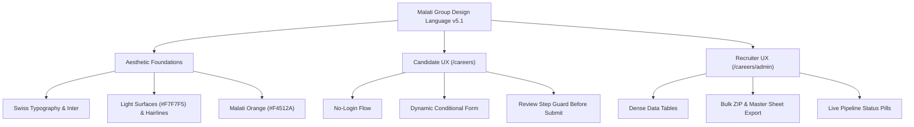

# Malati Group Recruitment Portal — UI/UX & Design Language System

> **Version**: 5.1  
> **Brand**: Malati Group (Foundry & Precision Engineering)  
> **Core Philosophy**: *Precision in structure. Energy in orange. Clarity in white.*  
> **Target Audience**: Engineering graduates, machine operators, seasoned automotive specialists, and corporate HR recruiters.  
> **Primary URL Path**: `/careers` (with automatic root `/` &rarr; `/careers` redirection)

---

## 1. Executive Summary & Design Vision

The Malati Group Recruitment Portal design system reflects the company’s real-world identity: an engineering powerhouse rooted in high-grade foundry metallurgy and CNC/VMC precision machining. 

The aesthetic marries **Swiss International Typographic Style** with **Modern Industrial Precision**:
* **High Contrast & Clarity**: Clean white canvas (`#FFFFFF`) and light architectural surfaces (`#F7F7F5`) with bold charcoal typography (`#171717`).
* **Malati Orange Energy**: Vibrant brand orange (`#F4512A`) used intentionally for primary CTAs, active indicators, progress metrics, and key focus states.
* **Light, Air-Filled Structural Surfaces**: Rather than heavy pitch-black or dark charcoal blocks, the candidate portal footer and admin login authentication panel utilize light architectural grey (`#F7F7F5`) bordered by thin neutral lines (`#E5E5E5`).
* **Engineering Precision**: Razor-sharp hairline dividers, disciplined grid alignments, and restrained border radii (`6px` inputs, `10px` cards).
* **Zero-Friction Candidate UX**: No account registration or login barriers. A mobile-first, multi-step application wizard that adapts dynamically based on experience level with a deliberate review step before final submission.
* **Productive Admin Workspace**: High-density information architecture, instant filtering, visual pipeline tracking, and one-click bulk exports.



---

## 2. Core Design Principles

### 1. Form Follows Function (Industrial Utility)
Every visual element must serve an operational purpose. We reject arbitrary SaaS gradients, decorative 3D illustrations, and slow parallax animations. Interface elements resemble calibrated measuring tools—clean, exact, and unambiguous.

### 2. Velocity Over Bureaucracy
Candidates should never feel trapped in a corporate HR maze. By eliminating logins and using smart conditional branching (e.g. automatically hiding irrelevant fields when a candidate selects "Fresher"), we respect the applicant’s time. Applications can be completed in under 2 minutes on any mobile browser.

### 3. Review Before Commitment
Candidates complete their details step-by-step and arrive at a comprehensive review page. The form does not prematurely submit: applicants review all answers, have individual "Edit" shortcuts for each section, and only trigger final submission upon a conscious click on "Submit application".

### 4. Cohesive Light Architectural Environment
Both the candidate footer and admin login authentication panel maintain the portal's airy, premium white-and-light-grey aesthetic (`#F7F7F5`) with thin borders and orange micro-accents. Dark tones are reserved strictly for authoritative typography rather than large, overwhelming black blocks.

---

## 3. Design Tokens & Color Palette

### 3.1 Primary & Neutral Tokens

| Token Name | CSS Variable | Hex / Value | Usage & Context |
| :--- | :--- | :--- | :--- |
| **Ink** | `--color-ink` | `#171717` | Primary text, high-emphasis headings, active icons, solid secondary buttons. |
| **Charcoal** | `--color-charcoal` | `#262626` | Deep neutral elements, secondary headings. |
| **Muted** | `--color-muted` | `#6B6B6B` | Secondary descriptions, timestamps, metadata labels, field hints. |
| **Line** | `--color-line` | `#E5E5E5` | Hairline borders, structural section dividers, input field strokes. |
| **Surface** | `--color-surface` | `#F7F7F5` | Footer background, admin login left panel, table headers, disabled inputs, badges. |
| **White** | `--color-white` | `#FFFFFF` | Primary page canvas, card surfaces, input backgrounds. |

### 3.2 Brand Accent Palette (Malati Orange)

| Token Name | CSS Variable | Hex / Value | Usage & Context |
| :--- | :--- | :--- | :--- |
| **Malati Orange** | `--color-brand` | `#F4512A` | Primary CTAs, active navigation indicators, step numbers, progress bars. |
| **Orange Deep** | `--color-brand-dark` | `#D83B1E` | Primary CTA hover and active pressed state. |
| **Orange Light** | `--color-brand-light` | `#FFF1EC` | Input focus ring background, active card tint, selected radio backgrounds. |
| **Brand Line** | — | `#FFD7CB` | Subtle border around brand badges and selected components. |

### 3.3 Semantic & Pipeline Status Colors

| Status Category | Text Token | Background Token | Border Token | Usage Example |
| :--- | :--- | :--- | :--- | :--- |
| **New / Brand** | `#F4512A` (`--color-brand`) | `#FFF1EC` | `#FFD7CB` | `NEW` application pill, primary badges. |
| **Success / Positive** | `#17694A` (`--color-success`) | `#F1F8F4` | `#CCE3D8` | `SHORTLISTED`, `SELECTED`, live status indicator. |
| **Warning / Pending** | `#8A5A00` (`--color-warning`) | `#FDF8EC` | `#ECDCB9` | `UNDER REVIEW`, recruitment paused banner. |
| **Neutral / Inactive** | `#6B6B6B` (`--color-muted`) | `#F7F7F5` | `#E5E5E5` | `REJECTED`, draft jobs, general tags. |

---

## 4. Typography & Typesetting System

The typography is built around **Inter**, optimized with advanced OpenType feature flags (`"cv02"`, `"cv03"`, `"cv04"`, `"cv11"`) for enhanced legibility of numerals, capital letters, and technical codes.

```css
font-family: var(--font-inter), ui-sans-serif, system-ui, -apple-system, "Segoe UI", sans-serif;
```

### 4.1 Type Scale Hierarchy

| Style Role | CSS Class / Tags | Size / Line-Height | Weight & Tracking | Context / Purpose |
| :--- | :--- | :--- | :--- | :--- |
| **Hero Display** | `.display`, `h1` | `38px - 56px` / `1.06` | SemiBold (600), `-0.035em` | Homepage hero headlines. |
| **Section Title** | `h2` | `24px - 28px` / `1.2` | SemiBold (600), `-0.02em` | Major section titles. |
| **Card / Item Title** | `h3` | `15px - 18px` / `1.3` | Medium / SemiBold, `-0.015em` | Job titles, department cards, step headings. |
| **Body Standard** | `p`, `span` | `14px - 15px` / `1.6` | Regular (400), normal | Application forms, job descriptions. |
| **Eyebrows / Badges**| `.eyebrow` | `10px - 11px` / `1.0` | SemiBold (600), `+0.16em` uppercase | Section categories, status indicators. |
| **Data / Monospace** | `span.font-mono` | `11px - 13px` / `1.0` | Medium (500), tabular nums | Step numbers (`01`, `02`), Application IDs. |

---

## 5. Structural Surfaces: Footer & Admin Authentication

### 5.1 Candidate Page Footer
* **Background**: Light architectural grey (`--color-surface: #F7F7F5`) with a thin neutral top border (`--color-line: #E5E5E5`).
* **Brand Lockup**: Official Malati Orange angular `M` mark paired with crisp ink typography (`Wordmark`).
* **Accents**: Orange micro-bar (`h-1 w-6 bg-brand rounded-full`), orange section eyebrows, and orange contact icons.
* **Bottom Strip**: Subtle white tint (`bg-white/70`) with fine hairline divider for legal and location information.

### 5.2 Admin Login Authentication Panel
* **Left Presentation Panel**: Light architectural grey (`bg-surface`) with subtle technical grid motif (`brand-pattern`) and thin right border (`border-r border-line`).
* **Typography**: Dark ink headlines (`text-ink`), orange eyebrow, and muted supporting description.
* **Feature Badges**: Clean white rounded cards (`border border-line bg-white shadow-xs`) with Malati Orange check icons.
* **Right Authentication Card**: Pure white canvas (`#FFFFFF`) with the focused credential form.

---

## 6. Component Primitives & Ergonomics

### 6.1 Buttons
* **Primary (`.btn-primary`)**: Solid Malati Orange (`#F4512A`), hover Deep Orange (`#D83B1E`). Radius `6-7px`.
* **Secondary (`.btn-secondary`)**: Solid ink (`#171717`), hover black (`#000000`).
* **Outline (`.btn-outline`)**: White surface with hairline border (`#E5E5E5`). On hover, transitions to orange border and text.

### 6.2 Form Focus & Interactive States
```css
/* Accessible focus state */
:focus-visible {
  outline: 2px solid var(--color-brand);
  outline-offset: 2px;
  box-shadow: 0 0 0 3px var(--color-brand-light);
}

/* Input focus ring */
.input:focus,
.textarea:focus,
.select:focus {
  outline: none;
  border-color: var(--color-brand);
  box-shadow: 0 0 0 3px var(--color-brand-light);
}
```

---

## 7. URL Architecture & Subpath Deployment

The entire recruitment application operates under the `/careers` subpath:
* **Root Redirection**: `abc.com/` &rarr; `307 Redirect` &rarr; `abc.com/careers`
* **Public Careers Home**: `abc.com/careers`
* **Jobs Directory**: `abc.com/careers/jobs`
* **Department Views**: `abc.com/careers/departments`
* **Job Application Flow**: `abc.com/careers/jobs/[id]/apply`
* **Application Success**: `abc.com/careers/apply/success`
* **Recruitment Admin Console**: `abc.com/careers/admin`
* **API Endpoints**: `abc.com/careers/api/...`
