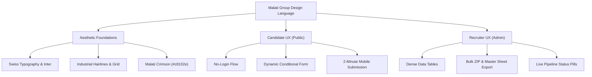
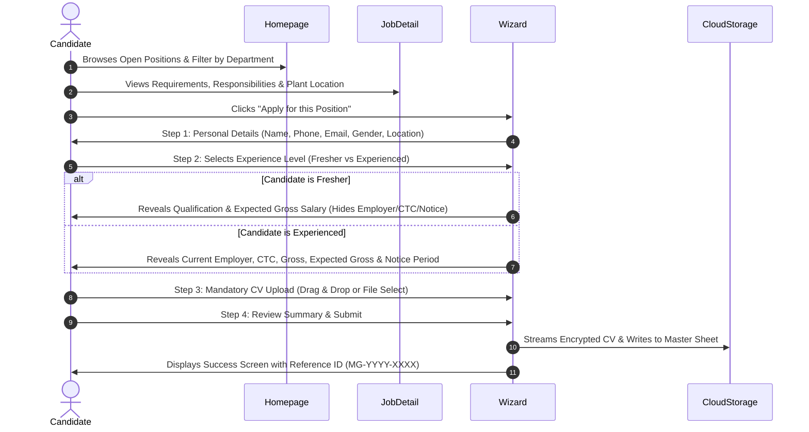
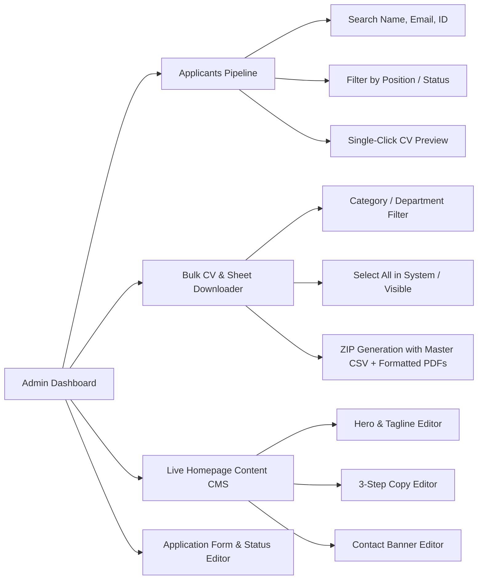

# Malati Group Recruitment Portal — UI/UX & Design Language System

> **Version**: 4.2  
> **Brand**: Malati Group (Foundry & Precision Engineering)  
> **Core Philosophy**: *Industrial Precision, Human Simplicity*  
> **Target Audience**: Engineering graduates, machine operators, seasoned automotive specialists, and corporate HR recruiters.

---

## 1. Executive Summary & Design Vision

The Malati Group Recruitment Portal design system reflects the company’s real-world identity: an engineering powerhouse rooted in high-grade foundry metallurgy and CNC/VMC precision machining. 

The aesthetic marries **Swiss International Typographic Style** with **Modern Industrial Utility**:
* **High Contrast & Readability**: Crisp deep charcoals on pure white surfaces with generous negative space.
* **Engineering Precision**: Razor-sharp hairline dividers, disciplined grid alignments, and restrained border radii.
* **Zero-Friction Candidate UX**: No account registration, password creation, or login barriers. A mobile-first, multi-step application wizard that adapts dynamically based on experience level.
* **Productive Admin Workspace**: High-density information architecture, instant filtering, visual pipeline tracking, and one-click bulk exports.



---

## 2. Core Design Principles

### 1. Form Follows Function (Industrial Utility)
Every visual element must serve an operational purpose. We reject arbitrary gradients, decorative 3D illustrations, and slow parallax animations. Interface elements resemble calibrated measuring tools—clean, exact, and unambiguous.

### 2. Velocity Over Bureaucracy
Candidates should never feel trapped in a corporate HR maze. By eliminating logins and using smart conditional branching (e.g. automatically hiding 6 irrelevant fields when a candidate selects "Fresher"), we respect the applicant’s time. Applications can be completed in under 2 minutes on any mobile browser.

### 3. Progressive Disclosure
Complex technical information (such as comprehensive machine shop job descriptions or admin candidate payloads) is presented in structured layers. First the essential overview, followed by deep details on demand.

### 4. High-Signal Micro-Interactions
Interactive elements react with crisp 150ms transitions. Error states provide exact, human-readable correction guidelines directly beside the field rather than generic modal popups.

---

## 3. Design Tokens & Color Palette

### 3.1 Primary & Neutral Tokens

| Token Name | CSS Variable | Hex / Value | Usage & Context |
| :--- | :--- | :--- | :--- |
| **Ink** | `--color-ink` | `#111111` | Primary text, high-emphasis headings, active icons, solid dark buttons. |
| **Muted** | `--color-muted` | `#666666` | Secondary descriptions, timestamps, metadata labels, field hints. |
| **Line** | `--color-line` | `#e7e7e7` | Hairline borders, structural section dividers, input field strokes. |
| **Surface** | `--color-surface` | `#f6f6f6` | Alternate section backgrounds, table headers, disabled inputs, badges. |
| **White** | — | `#ffffff` | Primary background, card surfaces, input backgrounds. |

### 3.2 Brand Accent Palette (Malati Crimson)

| Token Name | CSS Variable | Hex / Value | Usage & Context |
| :--- | :--- | :--- | :--- |
| **Brand Crimson** | `--color-brand` | `#c8102e` | Primary CTAs, active highlights, key brand wordmark, validation errors. |
| **Brand Dark** | `--color-brand-dark` | `#a20d25` | Primary CTA hover and active pressed state. |
| **Brand Surface** | — | `#fdf3f5` | Crimson badge backgrounds, subtle warning cards, active row highlight. |
| **Brand Line** | — | `#f0ccd3` | Subtle border around brand badges and selected components. |

### 3.3 Semantic & Pipeline Status Colors

| Status Category | Text Token | Background Token | Border Token | Usage Example |
| :--- | :--- | :--- | :--- | :--- |
| **New / Brand** | `#c8102e` (`--color-brand`) | `#fdf3f5` | `#f0ccd3` | `NEW` application pill, primary badges. |
| **Success / Positive** | `#17694a` (`--color-success`) | `#f1f8f4` | `#cce3d8` | `SHORTLISTED`, `SELECTED`, live status indicator. |
| **Warning / Pending** | `#8a5a00` (`--color-warning`) | `#fdf8ec` | `#ecdcb9` | `UNDER REVIEW`, recruitment paused banner. |
| **Neutral / Inactive** | `#666666` (`--color-muted`) | `#f6f6f6` | `#e7e7e7` | `REJECTED`, draft jobs, general tags. |

---

## 4. Typography & Typesetting System

The typography is built around **Inter**, optimized with advanced OpenType feature flags (`"cv02"`, `"cv03"`, `"cv04"`, `"cv11"`) for enhanced legibility of numerals, capital letters, and technical codes.

```
Font Stack: var(--font-inter), ui-sans-serif, system-ui, -apple-system, "Segoe UI", sans-serif
```

### 4.1 Type Scale Hierarchy

| Style Role | CSS Class / Tags | Size / Line-Height | Weight & Tracking | Context / Purpose |
| :--- | :--- | :--- | :--- | :--- |
| **Hero Display** | `.display` | `38px` – `56px` / `1.08` | `600`, `-0.035em` | Homepage hero headline, high-impact statements. |
| **Section Heading (H1)** | `h1` | `28px` – `32px` / `1.15` | `600`, `-0.03em` | Page headers, job role titles. |
| **Sub-section (H2)** | `h2` | `22px` – `26px` / `1.25` | `600`, `-0.02em` | Section headers ("Open Positions", "Hiring Departments"). |
| **Card Heading (H3)** | `h3` | `14px` – `16px` / `1.3` | `600`, `-0.01em` | Job card titles, step process titles, admin group titles. |
| **Eyebrow** | `.eyebrow` | `10px` – `11px` / `1` | `600`, `+0.16em`, Uppercase | Department tags, status pre-headers, micro-labels. |
| **Body (Regular)** | `p`, `.input`, `.btn` | `14px` / `1.6` | `400` / `500`, Normal | General descriptions, form controls, primary body text. |
| **Caption / Meta** | `small`, `.hint` | `11px` – `12.5px` / `1.5` | `400` / `500`, Normal | Helper hints, timestamp metadata, candidate IDs. |
| **Monospace / Code** | `code`, `.font-mono` | `10px` – `12px` / `1` | `500`, Normal | Application IDs (`MG-2611-XXXX`), technical keys. |

### 4.2 Typographic Principles
* **`text-wrap: balance`** on all titles to prevent awkward orphan words.
* **`text-wrap: pretty`** on body paragraphs to maintain aesthetic paragraph edges.
* **Strict Tabular Numbers** for compensation figures (CTC, Gross Salary) and application dates.

---

## 5. Layout & Spatial System

### 5.1 Spacing Scale & Radius Hierarchy

Interfaces follow an 8-point base grid for major structural padding and a 4-point micro-grid for form controls.

```
Radius Tokens:
  --radius-xs: 3px   -> Small button tags, micro-badges
  --radius-sm: 5px   -> Inputs, dropdowns, primary buttons (.btn)
  --radius-md: 7px   -> Sub-cards, grouped containers
  --radius-lg: 10px  -> Main surface cards, modals, admin cards
  Pill (999px)       -> Status badges (.badge)
```

### 5.2 Layout Containers
* **Public Page Container (`.container-page`)**:
  * Maximum width: `1180px`
  * Padding: `20px` (mobile) &rarr; `28px` (desktop md+)
  * Centered automatically (`margin-inline: auto`)
* **Admin Layout Shell**:
  * Sticky left desktop sidebar (`240px` width) with brand wordmark and categorized tools.
  * Collapsible mobile navigation drawer with touch burger toggle.
  * Fluid content workspace with sticky floating action toolbars for batch processing.

---

## 6. Component Library & Patterns

### 6.1 Buttons (`.btn`)
All interactive buttons meet mobile accessibility requirements with a minimum hit target of `44px` on public pages, and ergonomic `36px` / `30px` variants in data-heavy admin views.

* **Primary (`.btn-primary`)**: Solid Malati Crimson (`#c8102e`) with white text. Used exclusively for core conversion goals: *"Apply Now"*, *"Submit Application"*, *"Download Package"*.
* **Secondary (`.btn-secondary`)**: Solid Charcoal Ink (`#111111`) with white text. Used for secondary high-priority actions: *"Filter"*, *"Select All"*, *"Save Settings"*.
* **Outline (`.btn-outline`)**: White background with hairline border (`--color-line`). Turns dark on hover.
* **Ghost (`.btn-ghost`)**: Transparent background. Used for tertiary actions: *"Clear Filters"*, *"Cancel"*.

### 6.2 Form Controls & Field Validation
* **Inputs & Selects (`.input`, `.select`, `.textarea`)**:
  * 1px solid hairline (`#e7e7e7`).
  * Smooth focus transition: `border-color: #111111` with `box-shadow: 0 0 0 1px #111111`.
  * Distinct error highlight (`.field-error`): 1px border in Crimson (`#c8102e`).
* **Labels & Hints**:
  * `.label`: 13px medium weight (`500`) with mandatory red asterisk indicator (`*`).
  * `.hint`: 12px muted text positioned directly beneath the input for context.

### 6.3 Badges & Status Pills (`.badge`)
Rounded pill components with uppercase micro-typography (`10px`, letter-spacing `0.07em`).
* `.badge-brand`: For active/new statuses.
* `.badge-success`: For approved, selected, or live items.
* `.badge-warning`: For under review or paused recruitment.
* `.badge-muted`: For closed or rejected items.

### 6.4 Data Tables (`.table-base`)
Engineered for rapid recruitment scanning:
* Condensed row padding (`13px 14px`).
* Subtle row hover highlight (`#fcfcfc`).
* Uppercase tracking header row on light surface background (`#f6f6f6`).
* Responsive overflow scroll container for tables with numerous columns.

---

## 7. Public Candidate Experience (UX Architecture)

The candidate journey is optimized for speed, clarity, and zero drop-off.



### Key Public UX Innovations
1. **Dynamic Conditional Branching**:
   * Choosing **Fresher** hides 5 complex corporate questions and automatically assigns `current_employer: "N/A - Fresher"`, `experience_years: "0"`, and `notice_period: "Immediate"`, while keeping Expected Gross Salary visible.
   * Choosing **Experienced** prompts for full compensation transparency and mandatory notice period.
2. **Mandatory CV Upload with Instant Pre-Validation**:
   * Immediate client-side validation of file format (`.pdf`, `.doc`, `.docx`) and file size limit (`4 MB`) before upload begins.
3. **Sticky Review Step**:
   * Before sending, candidates see a read-only structured breakdown of their responses with a single-click back button to make corrections.

---

## 8. Recruiter & Admin Workspace (UX Architecture)

The administrative experience is designed for high-volume recruitment cycles:



### Key Admin UX Innovations
1. **Bulk Download Manager (`/admin/tools/bulk-download`)**:
   * Solves the bottleneck of downloading applicant CVs one by one.
   * Allows recruiters to select individual candidates, select all visible in a category, or export the entire database.
   * Automatically packages a ZIP archive containing:
     * Root file: `Applicants_Master_Export_YYYY-MM-DD_HH-mm-ss.csv` (complete up-to-date applicant data with UTF-8 BOM for Microsoft Excel).
     * `CVs/` folder: All selected resumes renamed uniformly as `<CandidateName>_<ApplicationID>.pdf`.
2. **Real-Time Landing Page CMS (`/admin/settings`)**:
   * Recruiters can update the public hero headline, subtitles, highlight tags, 3-step process descriptions, and contact banners without touching any code or restarting servers.
3. **Single-Click Auditability**:
   * Every administrative action (status updates, setting changes, job creation) is tracked with timestamp and actor email in the system audit log.

---

## 9. Accessibility & Performance Standards

* **WCAG 2.1 AA Compliance**:
  * Text contrast ratios exceed `4.5:1` against their respective backgrounds (`#111111` on white exceeds `16:1`).
  * Form inputs feature distinct `:focus-visible` outlines with high-contrast 2px offsets.
* **Motion Accessibility**:
  * CSS queries detect `prefers-reduced-motion: reduce` and disable transitions/animations for vestibular comfort.
* **Mobile Touch Ergonomics**:
  * Primary navigation, filters, and submit buttons feature minimum touch heights of `44px`.
  * Responsive data tables support horizontal gesture scrolling without clipping page margins.
* **Asset Optimization**:
  * Next.js static page generation where feasible with dynamic server-rendered data hydration.
  * Direct streaming of CV blobs to Cloudinary with secure delivery headers.

---

## 10. Summary Cheat Sheet for Developers & Designers

```bash
# Colors
--color-ink:      #111111   (Headlines, Primary Text)
--color-muted:    #666666   (Descriptions, Subtext)
--color-line:     #e7e7e7   (Borders, Dividers)
--color-surface:  #f6f6f6   (Card Backgrounds, Headers)
--color-brand:    #c8102e   (CTA Crimson, Critical Actions)

# Radius
--radius-sm:      5px       (Inputs, Buttons)
--radius-lg:      10px      (Cards, Modals)
Pill:             999px     (Status Pills)

# Typography
Headlines:        Inter Display, Tight tracking (-0.03em)
Eyebrows:         10px - 11px, Uppercase, Wide tracking (+0.16em)
Body:             14px - 15px, Line-height 1.6
Identifiers:      Monospace (MG-YYMM-XXXX)
```
