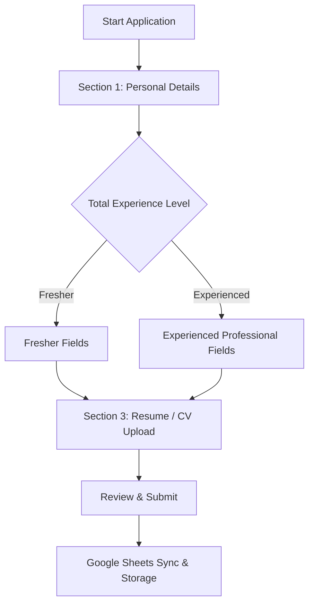

# Malati Group Recruitment Portal — Candidate Application Form Specification (v2)

> **Document Status**: Ready for Review / Implementation on Request  
> **Target Version**: Next.js App Router Candidate Application Flow  
> **Primary Changes**: Refined 2-section core flow (Personal Details & Professional Details) with smart conditional branching for **Fresher** vs **Experienced** candidates.

---

## 1. Overview & Objectives

The application form is designed to be streamlined, mobile-first, and friction-free. Candidates will be presented with a dynamic form that adapts based on their professional experience level, hiding irrelevant corporate compensation fields for freshers while capturing complete salary and organizational details for experienced professionals.



---

## 2. Section Breakdown & Field Matrix

### Section 1: Personal Details
All personal details are mandatory to ensure recruiters can contact the applicant.

| Field Name | Technical Key | Input Type | Required | Description / Helper Text | Validation Rules |
| :--- | :--- | :--- | :--- | :--- | :--- |
| **Full Name** | `candidate_name` | `text` | **Yes** | *"As it appears on your government ID or certificates."* | Min 2 chars, Max 120 chars, letters & spaces. |
| **Email Address** | `email` | `email` | **Yes** | *"We will send your application receipt and updates here."* | Valid email pattern (`RFC 5322`). |
| **Phone Number** | `phone` | `tel` | **Yes** | *"10-digit mobile number for WhatsApp & calls."* | Standard 10-digit Indian phone (or with country code). |
| **Gender** | `gender` | `select` | **Yes** | *"Select your gender."* | Options: `Male`, `Female`, `Other` |
| **Current Location** | `location` | `text` | **Yes** | *"City, State (e.g. Kolhapur, Maharashtra)."* | Min 2 chars, Max 100 chars. |

---

### Section 2: Professional Details (Dynamic Branching)

#### Branch Trigger: Total Experience
* **Field Label**: `Total Experience`
* **Technical Key**: `experience_type` (or `experience_level`)
* **Input Type**: Dropdown menu (`<select>`)
* **Options**:
  1. `Fresher` (No prior professional full-time experience)
  2. `Experienced` (Has prior full-time industrial/work experience)

---

#### Scenario A: If "Fresher" is Selected

When `Fresher` is chosen, all past organizational and compensation history fields are **hidden and cleared**.

| Field Name | Technical Key | Visible? | Required? | Input Type | Description / Notes |
| :--- | :--- | :--- | :--- | :--- | :--- |
| **Experience Type** | `experience_type` | **Yes** | **Yes** | Dropdown | Set to `"Fresher"` |
| **Highest Qualification** | `qualification` | **Yes** | **Yes** | Text / Select | Degree/Diploma (e.g. B.E. Mechanical, Diploma, ITI) |
| **Current Organisation** | `current_employer` | ❌ **Hidden** | No | — | Automatically set to `"N/A - Fresher"` |
| **No. of Years Experience**| `experience_years` | ❌ **Hidden** | No | — | Automatically set to `"0"` |
| **Current Salary (CTC)** | `current_ctc` | ❌ **Hidden** | No | — | Automatically set to `"N/A"` |
| **Current Gross Salary** | `current_gross` | ❌ **Hidden** | No | — | Automatically set to `"N/A"` |
| **Expected Gross Salary** | `expected_gross` | **Yes** | **Yes** | Text / Number | Expected monthly gross or annual compensation |
| **Notice Period** | `notice_period` | ❌ **Hidden** | No | — | Automatically set to `"Immediate"` |

---

#### Scenario B: If "Experienced" is Selected

When `Experienced` is chosen, the detailed employment, compensation, and availability fields are dynamically rendered.

| Field Name | Technical Key | Visible? | Required? | Input Type | Description / Helper Text |
| :--- | :--- | :--- | :--- | :--- | :--- |
| **Experience Type** | `experience_type` | **Yes** | **Yes** | Dropdown | Set to `"Experienced"` |
| **No. of Years Experience**| `experience_years` | **Yes** | **Yes** | Text / Number | E.g., `4.5 years` or numerical years |
| **Current Organisation** | `current_employer` | **Yes** | **Yes** | Text | Current or most recent employer/company name |
| **Current Salary (CTC Drawn)** | `current_ctc` | **Yes** | **Yes** | Text / Number | E.g. `₹ 4.5 LPA` (Annual Cost to Company) |
| **Current Gross Salary Drawn** | `current_gross`| **Yes** | **Yes** | Text / Number | E.g. `₹ 32,000 / month` |
| **Expected Gross Salary** | `expected_gross`| **Yes** | **Yes** | Text / Number | E.g. `₹ 40,000 / month` |
| **Notice Period** | `notice_period` | **Yes** | **Yes** | Select | **Mandatory**: `Immediate`, `15 Days`, `30 Days`, `45 Days`, `60 Days`, `90 Days` |

---

### Section 3: Documents & Additional Information

| Field Name | Technical Key | Input Type | Required | Description |
| :--- | :--- | :--- | :--- | :--- |
| **Resume / CV Upload** | `cv` | `file` | Optional / Recommended | PDF, DOC, DOCX up to 4 MB (uploaded to Cloudinary/Drive). |
| **Additional Information** | `additional_info` | `textarea` | Optional | Certifications, machine expertise, skills, or comments. |

---

## 3. UI & Interaction Logic (Client Component)

### State Handling
```typescript
interface ApplicationFormState {
  // Personal
  candidate_name: string;
  email: string;
  phone: string;
  location: string;

  // Professional
  experience_type: "fresher" | "experienced" | "";
  qualification: string;
  
  // Conditional for Experienced
  experience_years: string;
  current_employer: string;
  current_ctc: string;
  current_gross: string;
  expected_gross: string;
  notice_period: string;

  // Additional
  additional_info: string;
  cv: File | null;
}
```

### Dynamic Switch Rules
1. When candidate switches from **Experienced** to **Fresher**:
   - `current_employer`, `current_ctc`, `current_gross`, and `experience_years` are automatically cleared to avoid submitting residual stale data.
   - `notice_period` is automatically defaulted to `"Immediate"`.
2. Step navigation validation:
   - If `experience_type === "fresher"`, skip validation for salary, current employer, and notice period fields.
   - If `experience_type === "experienced"`, require `current_employer`, `experience_years`, `current_ctc`, `current_gross`, `expected_gross`, and **`notice_period`**.

---

## 4. Google Sheets Database Mapping

The Google Sheets **`WITH_CV`** and **`WITHOUT_CV`** tabs will store the captured fields:

| Sheet Column Header | Mapping / Value Source | Example (Fresher) | Example (Experienced) |
| :--- | :--- | :--- | :--- |
| `application_id` | System UUID / Reference Code | `MG-2611-9A3E4F` | `MG-2611-9A3E4F` |
| `position_id` | Position ID applied for | `POS-018` | `POS-018` |
| `candidate_name` | Section 1 Full Name | `Amit Kumar` | `Suresh K. Patil` |
| `email` | Section 1 Email | `amit@example.com` | `suresh@example.com` |
| `phone` | Section 1 Phone | `+91 98765 43210` | `+91 98220 12345` |
| `location` | Section 1 Location | `Kolhapur, Maharashtra` | `Ichalkaranji, Maharashtra` |
| `experience` | Formatted Experience Summary | `Fresher (0 yrs)` | `5.5 years (Kirloskar Oil Engines)` |
| `qualification` | Highest Qualification | `B.E. Mechanical (2024)` | `Diploma in Mechanical` |
| `current_employer` | Current Employer Name | `Fresher` | `Precision Castings Pvt Ltd` |
| `current_ctc` | Current Annual CTC | `N/A` | `₹ 4.8 LPA` |
| `current_gross` | Current Monthly Gross Salary | `N/A` | `₹ 36,000 / month` |
| `expected_gross` | Expected Monthly Gross Salary| `₹ 25,000 / month` | `₹ 45,000 / month` |
| `notice_period` | Availability / Notice Period | `Immediate` | `30 Days` |
| `cv_file_id` | Cloudinary Storage ID | `cloudinary:...` | `cloudinary:...` |
| `status` | Initial Status | `NEW` | `NEW` |
| `created_at` | ISO Timestamp | `2026-11-06T16:30:00Z` | `2026-11-06T16:30:00Z` |

---

## 5. Admin Portal Display Updates

In the Admin Portal (`/admin/applicants/[id]`):
1. **Candidate Profile Card**:
   - Shows badge: `Fresher` (emerald pill) or `Experienced` (slate pill).
2. **Employment & Compensation Card**:
   - If `Fresher`: Displays a clean message: *"Candidate is a Fresher with no prior corporate employment history."*
   - If `Experienced`: Displays a structured 2x2 grid:
     - **Current Employer**: Precision Castings Pvt Ltd
     - **Total Experience**: 5.5 years
     - **Current CTC Drawn**: ₹ 4.8 LPA
     - **Current Gross Salary**: ₹ 36,000 / month
     - **Expected Gross Salary**: ₹ 45,000 / month

---

## 6. Implementation Action Plan (Awaiting User Signal)

When directed to implement:
- [ ] **Step 1**: Update `FORM_FIELDS` and `FORM_OPTIONS` seed definitions in `lib/seed.ts` and `lib/types.ts`.
- [ ] **Step 2**: Update `components/application-form.tsx` with dynamic dropdown branching for `Fresher` vs `Experienced`.
- [ ] **Step 3**: Update server validation in `lib/submission.ts` to enforce conditional validation based on `experience_type`.
- [ ] **Step 4**: Update admin view in `app/admin/(portal)/applicants/[id]/page.tsx` to display the new salary and employer fields cleanly.
- [ ] **Step 5**: Run end-to-end verification and build check.
